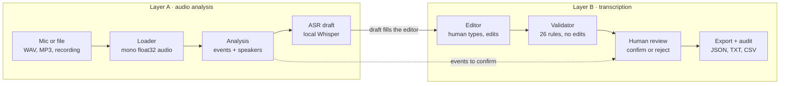

# Ermis V2 Speech Annotation & QA Assistant — Project Documentation

As of 26 Oct 2026 · Deepak Kumar

---

## 1. Overview

The Ermis V2 Speech Annotation & QA Assistant is a local Windows desktop app.
It helps an annotator produce a transcription that follows the Ermis
Transcription V2 rules, and it catches rule violations before the file is
submitted. All 9 planned build phases are complete and 1,552 automated tests
pass (run on 26 Oct 2026).

The app records or loads audio and analyses it. It can draft the words with a
local speech model and checks the text against every V2 rule. It also keeps an
audit trail of every decision. The guiding rule is that **the audio is the
source of truth**: the app assists and checks, and a person makes the final
call.

| Item | Value |
| --- | --- |
| Platform | Windows desktop (PySide6), plus a headless command line |
| Language | Python 3.10+ |
| Code size | about 24,000 lines of Python, tests included |
| Tests | 1,552 passing, run in about 48 s |
| Processing | Fully local: no cloud, no telemetry, no stored credentials |
| Project folder | `Downloads/audiodd` |
| Specification | `CLAUDE.md` (60 sections), deviations logged in section 60 |

---

## 2. Features

The app covers the whole annotation loop: input, analysis, drafting, editing,
checking and export.

| Feature | What it does |
| --- | --- |
| Recording | Mic capture with a device picker, a level meter (dBFS) and an elapsed clock. It saves mono 16-bit WAV at 48 kHz to `data/recordings/` and stops by itself after 30 minutes. |
| Audio loading | Loads WAV with the standard library and other formats through FFmpeg. Playback has speed control and segment replay. |
| Audio analysis | Detects speech, pauses, laughter, `[hn]` sounds, artifacts, background speech, overlap and speaker changes. These are internal events only. |
| ASR drafting | Ctrl+D drafts the words with a local Whisper model, already in V2 spoken form, with speaker and event tags. |
| Transcription editor | Plain-text editor with a tag palette for every V2 tag, undo/redo, save and export. |
| Validator | Checks the text live and lists findings as ERROR, WARNING or INFO. Each finding cites its spec section. It never edits the text. |
| Speaker panel | Shows the speaker count, gender (`msv`/`fsv`/`unknown`) and nativity. Speakers can be merged, split, added or removed. |
| Event confirmation | Each uncertain detection can be played, then confirmed, changed or rejected before it becomes a tag. |
| Export | Exports JSON, TXT and CSV. Each export records whether the text is human-reviewed or an ASR draft. |
| Audit log | Records detections, confirmations, edits, validation results and metadata changes. Rows can only be added. |

### What a draft contains

- Words in V2 spoken form: lowercase, no sentence punctuation, numbers as
  words, `okay` → `ok`, `mhm` → `mm-hm`.
- `((word))` where the model was unsure, and `(())` where speech is audible but
  nothing could be recognised.
- `<s1>`, `<s2>` speaker tags in order of first appearance. Single-speaker
  audio gets none.
- `[laughter]`, `[hn]`, `[artifact]` and `[bg]` above a confidence threshold,
  in alphabetical order with repeats collapsed.
- A whole-file tag on its own (`<na>`, `<ga>`, `<ns>`) when that is what the
  clip is. Blank or garbled audio is never sent to the model.
- Never a pause tag and never a retired V1 tag.

---

## 3. Architecture

The app keeps two layers apart. Layer A analyses the audio and produces
internal events. Layer B is the transcription text. A detected event becomes a
tag only after a person confirms it, or after the ASR draft auto-confirms it
under a separate audit label.



Text reaches export only through the validator and a human review. Pause and
silence events stay internal. They are never inserted into the transcription.

### Module map

| Folder | Modules | Role |
| --- | --- | --- |
| `app/main.py` | CLI | Commands `gui`, `validate`, `analyse`, `draft`, `speakers`, `record`, `info`, `waveform`, `initdb` |
| `app/audio/` | loader, playback, recorder, preprocessing, waveform, quality | Decoding, playback, mic capture, shared features, `<na>`/`<ga>`/`<ns>` measurement |
| `app/detection/` | vad, silence, laughter, nonlexical, artifact, background, overlap, pipeline | Layer A detectors, run in dependency order |
| `app/asr/` | engine, draft | Whisper backends with word timings, and merging words, events and speakers into V2 text |
| `app/speakers/` | diarization, voice_profile, nativity, metadata | MFCC clustering, pitch-based gender, nativity suggestion, merge/split/renumber |
| `app/ermis/` | tags, rules, tokenizer, spoken_form, whole_file, findings, validator | The rule engine. `tags.py` is the single source of truth for the tag inventory. |
| `app/models/` | event | Analysis events and the confirmation gate |
| `app/storage/` | schema.sql, database, audit, export | SQLite, append-only audit, JSON/TXT/CSV export |
| `app/ui/` | main_window, waveform_view, transcription_editor, validation_panel, speaker_panel, event_panel, record_bar, draft_worker | The PySide6 window and its panels |

### The confirmation gate

```python
event = AnalysisEvent(EventType.POSSIBLE_LAUGHTER, 7.42, 8.15, confidence=0.91)
event.tag          # raises UnconfirmedEventError
event.confirm()    # a person listened and agreed
event.tag          # '[laughter]'
```

Even a 99% confident detection cannot write a tag through this API until
`confirm()` is called.

---

## 4. Install and usage

The core needs only NumPy and SciPy. Everything else is optional and switches
on a feature.

```bash
pip install -r requirements.txt
pip install faster-whisper        # drafting backend (recommended)
# or: pip install torch transformers
```

| Package | Needed for |
| --- | --- |
| numpy, scipy | Validator, storage, loader, waveform and the whole analysis engine |
| PySide6 | The desktop window |
| sounddevice | Playback and mic recording |
| soundfile | Faster audio decoding (optional) |
| FFmpeg on PATH | Any format other than PCM WAV |
| faster-whisper or torch + transformers | ASR drafting only |

### Configuration

Settings live in an optional, git-ignored `config.local.json` in the project
root. The current file uses the smaller model and forbids network downloads:

```json
{
  "asr": {
    "model": "openai/whisper-base.en",
    "downgrade_when_memory_is_tight": true,
    "preload_on_start": false,
    "local_files_only": true
  }
}
```

### Commands

| Command | What it does |
| --- | --- |
| `python -m app.main gui clip.wav` | Opens the annotation window |
| `python -m app.main validate "play [hn] music"` | Validates text. Exits 0 with no errors, 1 otherwise. |
| `python -m app.main analyse clip.wav` | Prints the analysis timeline and speaker lanes |
| `python -m app.main draft clip.wav` | Drafts the words with the local model |
| `python -m app.main speakers clip.wav` | Prints the speaker panel with its evidence |
| `python -m app.main record --seconds 30` | Records from the microphone |
| `python -m app.main info clip.mp3` | Shows audio file details |
| `python -m app.main waveform clip.wav` | Draws an ASCII waveform |
| `python -m app.main initdb` | Creates the SQLite database |

Add `--json` to `validate`, `analyse`, `draft` or `speakers` for
machine-readable output. In the window, Ctrl+D drafts the open clip.

---

## 5. Validation rules

The validator enforces all 26 mandatory rules of spec section 54. The full
rule reference is in [validation-rules.md](validation-rules.md).

| Area | Example checks | Example finding |
| --- | --- | --- |
| Formatting | Lowercase, forbidden punctuation, invalid spaces, tag syntax | ERROR: forbidden punctuation "?" |
| Numbers | Digits where words are required | `23` should be written as words |
| Backchannels | `mhm`, `uh huh`, `mm mm`, `nuh uh`, `hm`, `umm`, `uhh` | expected `mm-hm` |
| Tags | Unknown tags, wrong order, duplicate `[hn] [hn]`, bad spacing | tags must be alphabetical |
| Retired V1 tags | `[cough]`, `[sigh]`, `<hum>`, `<ws>`, `<sg>`, `<i>` and others | ERROR: use `[hn]` under V2 |
| Speaker tags | Numbering by first appearance, `<s1>` in single-speaker audio | `<s1>` not allowed with one speaker |
| Overlap | Unclosed `<ol>`, stray `</ol>`, missing speakers inside, `<ct>` inside `<ol>` | `<ct>` must not be nested |
| Unintelligible and mis-spoken | Malformed `(())` or `{{}}`, spaces inside, empty braces | `( ( ) )` is malformed |
| Truncation | Hyphen placement on cut-off words | WARNING: check the audio |
| Whole-file tags | `<ga> <na> <ns> <nt> <sc>` mixed with other text | ERROR: `<na> hello` |

### What it deliberately does not check

Some rules can only be settled by listening. Whether a hyphen marks a real
cut-off, `[artifact]` vs `<ga>`, and whether a repetition was spoken are
WARNINGs or not checked at all. A false alarm teaches annotators to ignore the
panel, so the validator does not guess. Every correct example in the spec is
tested to produce zero errors and zero warnings.

### Two conflicts inside the spec

1. Section 20 shows `[laughter] [bg]`, while section 41 requires alphabetical
   order. The validator treats `[bg]` as positional, so it is excluded from the
   ordering check.
2. `(())` and `<ct>` are valid both alone and inline. Only
   `<ga> <na> <ns> <nt> <sc>` must stand alone.

---

## 6. Detector reliability and limits

The detectors are hand-written signal-processing heuristics, not trained
models. They were tuned only on synthetic audio that the test suite generates,
so their accuracy on real recordings has not been measured.

| Detector | Reliability | Notes |
| --- | --- | --- |
| Silence / pause | High | Direct measurement; boundaries within about 20 ms |
| VAD | Good | Adaptive noise floor. Music, singing or engine hum can still read as speech. |
| Audio quality | Good | Clipping and dropouts are objective. `<ga>` vs `[artifact]` needs a listener. |
| `[artifact]` | Moderate | Tells a spike from a speech onset, but not a mic pop from a door slam |
| Diarization | Moderate | Correct on clean 1- and 2-speaker audio; tuned on synthetic voices |
| `[hn]` | Moderate | Cannot tell a cough from a sneeze from a desk thump |
| `[bg]` | Low | Who made a sound is a human judgement |
| `[laughter]` | Low | Speech syllables share laughter's 3–8 Hz rhythm |
| `<ol>` overlap | Lowest | Confidence capped at 0.55; echo and music mimic a second voice |

Confidence values are display figures, not probabilities. That is why every
uncertain detection waits for a person to confirm it.

### Model memory

A Whisper model that does not fit in memory crashes the app instead of raising
an error. The app checks free memory first and falls back to a smaller model,
or refuses.

| Model | Peak memory to load |
| --- | --- |
| tiny(.en) | about 0.6 GB |
| base(.en), current config | about 1.0 GB |
| small(.en), default | about 2.6 GB |
| medium(.en) | about 6.0 GB |

On an 8 GB machine the window and a command-line run cannot both hold a model,
so close one before drafting from the terminal.

---

## 7. Spec deviations

Three behaviours go against the written Ermis V2 spec. All were added on the
project owner's explicit request on 28 Aug 2026 and are logged in `CLAUDE.md`
section 60. The official Ermis workflow prohibits ASR-generated transcription,
so whether to use these features is a compliance decision for the owner.

| Deviation | What the spec says | What the app does |
| --- | --- | --- |
| ASR drafting | Sections 1 and 56.1: no ASR-generated transcription | A local Whisper model drafts the words |
| Auto-inserted tags | Section 47: a tag only after human confirmation | Detections above a confidence threshold become tags in the draft |
| Nativity suggestion | Sections 18A.4 and 37: never guess nativity | Suggests `native` / `nonnative` from fluency and `tts` from a synthetic-speech signature |

### Safeguards that still apply

- Recognition runs locally and audio is never uploaded.
  `privacy.allow_external_asr` cannot be enabled.
- Drafts are stored as `asr_draft`. The window title shows
  `[UNREVIEWED MACHINE DRAFT]`, and exporting an unreviewed draft is refused
  unless `allow_unreviewed=True` is passed.
- Tags a draft inserts are audited as `auto_confirmed_event`, separate from a
  human's `confirmed_event`.
- Uncertain words become `((word))` instead of being stated as fact.
- A draft never overwrites text the annotator typed.
- Nativity confidence is capped at 0.75 and falls back to `unknown` when
  evidence is thin. Recogniser confidence partly reflects accent, which is the
  evidence the spec excludes, so it has the smallest weight.

### How to switch the deviations off

These three settings return the app to the spec as written: analysis,
validation and QA over text a person typed.

```json
{
  "asr": { "enabled": false, "auto_draft_on_load": false },
  "speakers": { "suggest_nativity": false }
}
```

---

## 8. Privacy, storage, testing and packaging

### Privacy

- Everything runs on the local machine. Tests check that the loader, the
  analysis pipeline and the exporter open no network socket.
- The only network access is the one-time download of model weights.
  `asr.local_files_only = true` blocks even that.
- No passwords, tokens or API keys are stored. The config loader rejects any
  key that looks like a credential, and tests check that no database column or
  export field does.
- Microphone audio is written only to `data/recordings/`. The `data/` folder is
  git-ignored.

### Storage and audit

Data lives in a local SQLite database with tables for projects, audio files,
speakers, events, transcriptions, validation results and audit logs. SQLite
triggers block updates and deletes on the audit log. Each transcription save is
stored as a new revision, so no automatic process can destroy an annotator's
text.

### Testing

```bash
python -m pytest
```

| Test area | Files |
| --- | --- |
| Rule engine | `test_rules`, `test_tags`, `test_numbers`, `test_backchannels`, `test_truncations`, `test_tokenizer`, `test_coverage` |
| Speakers and overlap | `test_speakers`, `test_overlap`, `test_diarization`, `test_voice_profile`, `test_nativity` |
| Whole-file and edge cases | `test_whole_file`, `test_edge_cases` (spec cases A–P and every section 56 prohibition) |
| Audio | `test_audio`, `test_detection`, `test_playback`, `test_recorder` |
| Drafting | `test_asr`, `test_spoken_form`, `test_crosscheck` |
| Storage and export | `test_storage`, `test_export`, `test_config` |
| Interfaces | `test_ui` (Qt offscreen), `test_cli` |

Tests generate their audio as they run, so the repo has no binary fixtures. UI
tests skip if PySide6 is missing.

### Packaging

```bash
pip install pyinstaller
pyinstaller packaging/ermis-assistant.spec
```

FFmpeg is not bundled because of its licence. The spec also blocks whisper,
faster-whisper and torch, so a packaged build has no ASR drafting (see Open
items).

---

## 9. Open items

These were found while reviewing the project on 26 Oct 2026.

- [ ] Put the project in its own git repository. It currently sits untracked
      inside the home-folder repo and has no version history.
- [ ] Update the README test count from 1,474 to 1,552.
- [ ] Fix `requirements.txt`. Its closing note says no ASR package may be
      added, which contradicts the drafting install note above it.
- [ ] Decide whether the packaged .exe should support drafting. If yes, the
      PyInstaller spec needs to stop blocking whisper and torch.
- [ ] Measure the detectors on real recordings. All tuning so far uses
      synthetic audio.
- [ ] Confirm that the owner accepts the ASR and nativity deviations for the
      intended use of the output.
- [ ] Add the GitHub link, screenshots and a demo video to the portfolio case
      study.
